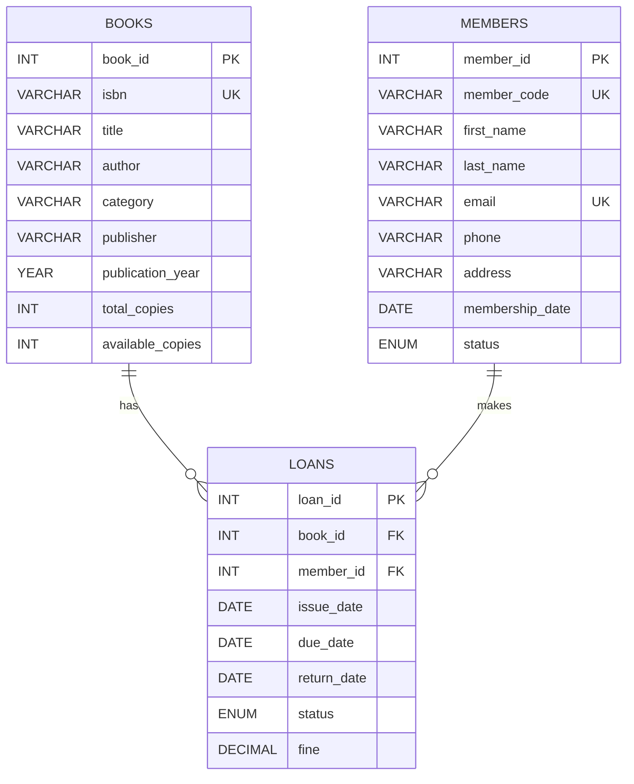

# Entity Relationship Diagram

## Relationships

- One book can have many loan records.
- One member can have many loan records.
- Each loan references exactly one book.
- Each loan references exactly one member.
